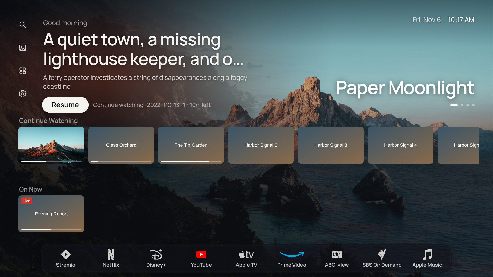
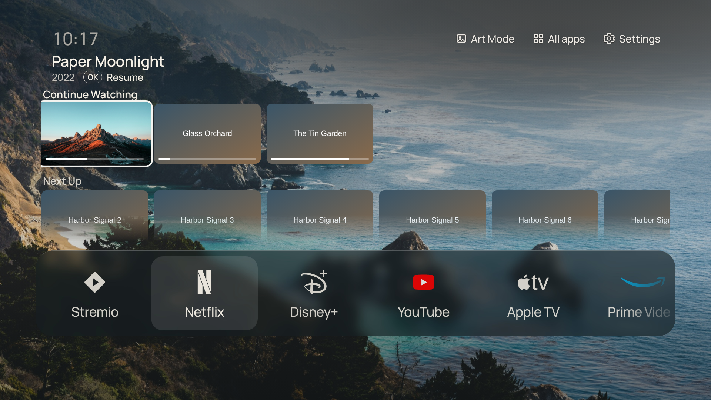

# Lobby for Jellyfin

The server half of Lobby, for Jellyfin. This is a from-scratch port of the [Emby plugin](../emby-plugin/README.md)
onto Jellyfin's plugin SDK: the same features, the same TV-facing API shape, a different media server underneath.

- **Rows:** Continue Watching, Next Up, Recently Added, On Now (Live TV), and Your Teams (Live TV sports matched
  against team names you choose per TV).
- **Seerr discovery:** Trending, Popular Movies and Popular Shows, each with its request status.
- **Requests from the TV**, made as the right Seerr user. Jellyfin accounts are linked to Seerr accounts
  automatically where possible. One Jellyfin login can link to several Seerr accounts for shared logins, in
  which case the TV asks who is requesting.
- **One-press playback:** Lobby tells the server what to play, then launches the Jellyfin app. The plugin waits
  for the Jellyfin app's session and sends Play, Resume (at the saved position) or Show Details.

Seerr's URL and API key stay on the Jellyfin server. TVs only ever hold their own Lobby token.

<p>
  
  
</p>

*(Invented titles — see [`docs/screenshots/README.md`](../docs/screenshots/README.md#lobby-screenshots-lobby-png). Both layouts run on whichever server is paired; this plugin provides the same rows and API as the Emby plugin.)*

## Install

1. Download `Lobby.dll` from the latest [release](https://github.com/CtznSniiips/Lobby/releases) tagged
   `jellyfin-plugin-v…`. For an unreleased build, use the artifact from the latest **Jellyfin plugin**
   workflow run.
2. Create a `Lobby` folder inside your Jellyfin `plugins` folder (e.g. `/config/plugins/Lobby` in the Docker
   container, or `plugins/Lobby` under Jellyfin's data directory) and copy `Lobby.dll` into it.
3. Restart Jellyfin.

## Set up

Open Dashboard → Plugins → Lobby. Setup is the same as the Emby plugin's (see its README), with "Jellyfin"
in place of "Emby" throughout: choose the Jellyfin account a TV acts as, link Jellyfin accounts to Seerr
accounts, and set the TV defaults for rows, sports and playback timing.

## TV API

Lobby's TV app talks to whichever plugin is paired exactly the same way — same JSON field names, same
request/response shapes, same semantics for rows, featured titles and playback. Only two things differ from
the Emby plugin's API, both because Jellyfin itself works this way rather than anything Lobby-specific:

- **No `/emby` path prefix.** The Emby plugin's endpoints sit under `/emby/Lobby/...` because Emby's own REST
  API is served from `/emby`. Jellyfin's API has no such prefix, so this plugin's endpoints are simply
  `/Lobby/...` (e.g. `/Lobby/Pair`, `/Lobby/Home`, `/Lobby/Admin/State`).
- **Item ids are Jellyfin GUIDs**, not Emby's decimal item ids. `ItemId`, `PlayItemId` and similar fields are
  opaque strings either way — Lobby on the TV never parses them, just round-trips whatever the server gave it
  back to `/Lobby/Play` — so this needs no change on the TV side.

Otherwise, every route, body and response field in the [Emby plugin's TV API table](../emby-plugin/README.md#tv-api)
applies unchanged: `/Lobby/Pair`, `/Lobby/Pair/Status`, `/Lobby/Ping`, `/Lobby/Home`, `/Lobby/Details`,
`/Lobby/Requesters`, `/Lobby/Request`, `/Lobby/Play`, `/Lobby/Resume/Dismiss`, `/Lobby/Settings` (get/post/reset),
`/Lobby/Sports/Teams` and `/Lobby/Search`.

## Build

Locally, with the .NET 8 SDK:

```sh
cd jellyfin-plugin/Lobby
dotnet build -c Release
```

This restores `Jellyfin.Controller`/`Jellyfin.Model` from NuGet at the version in `<JellyfinSdkVersion>`
(`Lobby.csproj`). The DLL is written to `bin/Release/net8.0/Lobby.dll`.

To build against local Jellyfin server assemblies instead (e.g. a non-public SDK version):

```sh
dotnet build -c Release -p:JellyfinRefDir=/path/to/jellyfin-server/bin
```

> **Note on this port's testing status:** this plugin was translated from the Emby plugin's C# (same business
> logic — pairing, Seerr linking, row building, sports matching, playback dispatch) onto Jellyfin's SDK
> (`MediaBrowser.Controller`/`MediaBrowser.Model` as Jellyfin ships them, ASP.NET Core MVC controllers in place
> of Emby's ServiceStack routes, `Guid` item/user ids in place of Emby's decimal ids, and
> `Microsoft.Extensions.Logging` in place of Emby's `ILogManager`). The first CI run against the real
> `Jellyfin.Controller`/`Jellyfin.Model` 10.9.11 packages caught several API-shape mistakes (Jellyfin has no
> `IServerEntryPoint` or `IHasThumbImage` — plugin startup now goes through an `IHostedService` registered by
> `PluginServiceRegistrator`, a replacement that only exists because Jellyfin's plugin API uses it internally
> too; `IDtoService.GetBaseItemDtos` is synchronous, not `GetBaseItemDtosAsync`; `ILiveTvManager`'s guide method
> is `GetPrograms`, not `GetProgramsAsync`, and both of its program queries already return `BaseItemDto`
> directly), which have since been fixed and cross-checked line-by-line against a local checkout of the
> `jellyfin/jellyfin` v10.9.11 source. It has **not yet run against a live Jellyfin server** — that, and a real
> compile on a machine with NuGet access, is the next real checkpoint. Please open an issue (or better, a PR)
> if either turns up something this review missed.

## Release

Releases are published by hand from Actions → **Jellyfin plugin release** → Run workflow.

1. Bump `<Version>` (and `AssemblyVersion`/`FileVersion`) in `Lobby/Lobby.csproj`.
2. Add a `## <version>` section to `CHANGELOG.md`. It becomes the release notes.
3. Merge to `main`, then run the workflow. Choose the Jellyfin SDK version to build against (default
   `10.9.11`) and optionally mark it as a pre-release.

The workflow refuses to run if the tag `jellyfin-plugin-v<version>` already exists, or if the changelog has
no section for that version. It builds through the regular **Jellyfin plugin** workflow, so the release uses
the same checks, then creates the tag and a GitHub Release with `Lobby.dll` attached.
